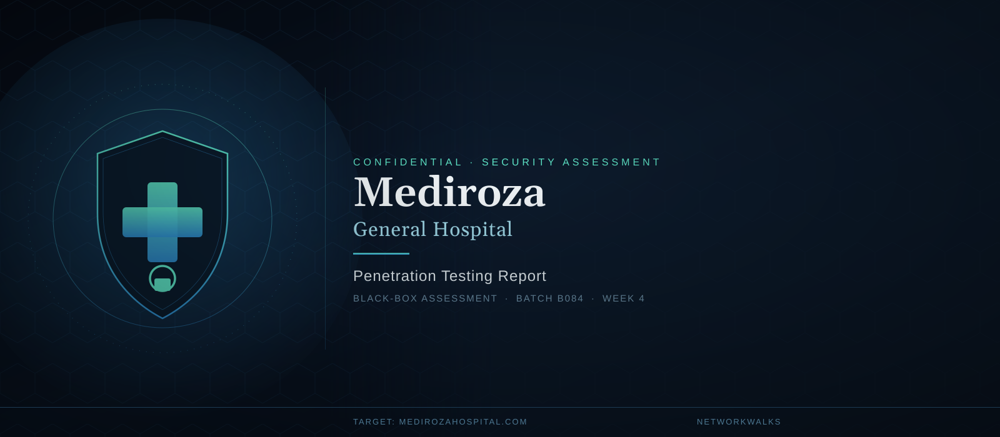
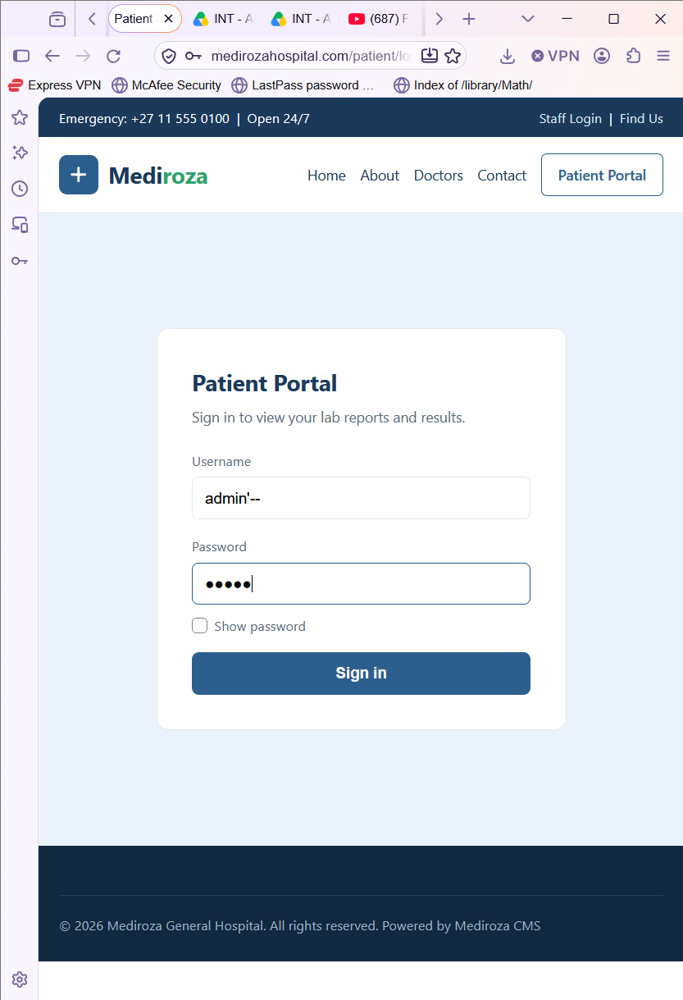

# Mediroza-General-Hospital-Penetration-Testing-Project

Mediroza General Hospital 

Penetration Testing Report

NetworkWalks Cybersecurity Internship Week 4 (Batch B084)

Assessment type : Black-box web application penetration test

Client : Mediroza General Hospital

Target : medirozahospital.com

Duration : 5 days

Authorization : Written permission granted

Overall reported risk : CRITICAL

1. Executive Summary
A black-box assessment of medirozahospital.com identified a Critical chain of vulnerabilities that together expose patient lab results, full employee payroll records, and hospital shareholder/ownership data to any unauthenticated internet user. No specialized exploitation framework was required — the exposure was reachable through a publicly listed backup directory, and the patient poral's document protection relied on weak, easily guessed passwords.

2. 
| # | Finding | Reported severity | Evidence status |
|---|---|---|---|
| 1 |  	robots.txt entry advertised a legacy directory, leading to an unauthenticated, world-readable database backup (medirozahospital_db_backup_2019.sql) containing full employee and shareholder tables | Critical |   Reported as retrieved without authentication   |
| 2 |  All 3 patient pathology reports retrieved from the Patient Portal were protected with weak passwords (123456, password, a short symbol string), cracked in seconds to minutes | Critical |Sensitive tables reportedly present in the SQL dump|
| 3 | Weak password protection on patient pathology PDFs | High | Three reports reportedly recovered |	Patient Portal login form showed signs consistent with SQL injection exposure  indicating the authentication
| 4 | Possible SQL injection in Patient Portal login | High  | Requires full HTTP request/response evidence and retest |
| 5 | WAF, rate-limiting, or intrusion detection — reconnaissance and credential attacks completed without any blocking or alerting | High | External observation only; control absence not proven    |

Overall risk to the client: Critical. The combination of an exposed database backup and weak document/account credentials means a motivated attacker with no special tooling could access protected health information (PHI), personally identifiable information (PII) of all staff, and confidential ownership/financial data within minutes of starting reconnaissance.

3.
 | Item | Details |
|---|---|
| Target | `https://medirozahospital.com` |
| Application areas | Production web application, Patient Portal, and Staff Portal (as described in the engagement notes) |
| Test type | Black-box penetration test |
| Duration | 5 days |
| Authorization | Written permission granted — Batch B084, Week 4 |
| Prior access | No credentials or internal documentation supplied |
| Scope restriction | Target domain only |
| Exclusions | No social engineering, denial-of-service testing, or testing outside the agreed scope |

 
Limitations
This was a scope-limited black-box assessment. No source-code review, internal network testing, physical testing, or social-engineering activity was performed. Findings reflect what the tester reports having observed from the public internet during the five-day window.

4. Methodology and Tools
The engagement followed a standard black-box workflow.

| Phase | Activities | Tools / approach recorded |
|---|---|---|
| Reconnaissance | Fingerprinting, WHOIS review, `robots.txt` review, directory enumeration | `whatweb`, `whois`, `curl`, `wget` |
| Access testing | Login-form behavior analysis and input-validation checks | Manual browser testing and SQL meta-character probes |
| Data exposure review | Retrieval and review of the reportedly exposed backup and patient documents | `wget`, Patient Portal UI |
| Password protection analysis | PDF password-strength assessment using dictionary-based testing | NetworkWalks Password Cracker lab tool; hash extraction and dictionary analysis |
| Data analysis | Review of SQL schema, table contents, and file metadata | Manual review |

%20%5BRunning%5D%20-%20Oracle%20VirtualBox%2023_11_2026%2012_45_58.png?raw=true)

5. Findings and Proof of Exploitation
Finding 1 — Sensitive Information Disclosure via robots.txt and Public Directory Listing (Critical)
robots.txt disallowed crawling of /patient/, /staff/, and /old/ — but since robots.txt is advisory-only and publicly readable, it directly revealed the existence of a legacy /old/ path to a human tester. That directory had listing enabled and contained an unauthenticated, downloadable database backup:
Index of /old/
mediroza_db_backup_2019.sql   2026-09-04 02:02   7k
The file was retrieved with a single unauthenticated HTTP GET (wget https://medirozahospital.com/old/mediroza_db_backup_2019.sql) — no login, token, or rate-limiting encountered. The 2026 server-side modification date on a file named _2019 suggests the backup is actively being touched or regenerated, not a true forgotten artifact — worth flagging to the client as a possible automated backup job still writing to a public path.

Finding 2  | Critical Data Exposure | Full Employee and Shareholder Records (Critical)
The exposed SQL backup contained complete, structured tables for hospital staff and ownership, with schema and data intact (not sanitized/sample data):
Shareholders table (10 rows, 100% of equity accounted for):
Shareholder	Share %	Shares Held	Class

| shareholder | share % | shares held | class  |
|---|---|---|---|
| Dr. Rajesh Naidoo |	18.0% |	180,000	| Ordinary |
| Cedar Health Holdings (Pty) Ltd |	15.0%	| 150,000	| Ordinary |
| Dr. Johan van der Merwe	 | 12.0% |	120,000	| Ordinary |
| Reddy Family Trust	| 11.0% |	110,000	| Ordinary |
| Thabo Molefe	| 10.0%	| 100,000 |	Ordinary |
| Sarah Botha |	9.0%	| 90,000	| Ordinary |
| Dr. Ahmed Kara	|8.0% |	80,000 |	Preferential |
| Naledi Zulu	| 7.0% |	70,000 |	Ordinary |
| Michael Roberts	| 6.0%	| 60,000	| Ordinary |
| Dr. Vikram Chetty	|4.0%	| 40,000	| Preferential |

Employee salary table (sample of recovered rows):

| Name	| Role	| Department |	Annual Salary |	Hired | 
|---|---|---|---|---|
| Dr. Suresh Moodley	| Consultant Radiologist	| Radiology |	130,000	| 2012-02-28 |
| Dr. Vikram Chetty	| Anaesthetist |	Theatre	| 135,000	| 2011-06-13 |
| Dr. Fatima Patel |	Pediatrician |	Pediatrics |	118,000 |	2013-10-17 |
| David Smith	| Facilities Manager |	Operations|	52,000	| 2014-10-27 |
| Nisha Singh |	Physiotherapist	|Rehabilitation |	48,000	| 2016-11-09 |
|  Radebe |	Radiographer|	Radiology	|43,000	| 2017-04-11 |
| Deepak Pillay |	Lab Technologist |	Diagnostics Lab	| 41,000 |	2015-05-20 |
| Peter van Wyk	|Procurement Officer |	Supply Chain |	38,000	| 2015-08-24 |
| Kavitha Govender |	Lab Technician	| Diagnostics Lab |	35,000	| 2018-08-06 |
| Karen O'Connor |	Billing Administrator	| Finance |	29,000	| 2018-03-19 |
| James Wilson	| Security Supervisor	| Operations	| 27,000	| 2019-09-02 |
| Andile Mbeki |	Ward Clerk |	Administration	| 21,000	| 2019-11-05 |
| Linda Fourie	| Receptionist	| Front Office	| 19,000 |	2020-02-10 |

Notable cross-reference: Dr. Vikram Chetty and Dr. Ahmed Kara appear in both tables — practicing clinicians who are simultaneously part-owners of the hospital, holding preferential-class shares. This is a governance/conflict-of-interest detail made visible purely as a side effect of the data breach, and should be called out to the client as a business-sensitivity point, not just a technical one.

Finding 3 
Weak Password Protection on Confidential Patient Records |High|
Three password-protected PDF lab reports were retrieved from the Patient Portal |patients S. Dlamini| P. Reddy | E. Thompson|. All three were cracked using straightforward dictionary attacks against the extracted PDF password hash:
|File	|Patient	Password |Recovered	Attempts to Crack|
|---|---|---|
|patient_report_1.pdf |	Sipho Dlamini |	!@#$%^&	3,582 / 3,592 (custom wordlist)|
|patient_report_2.pdf |	Priya Reddy	 |password	2 / 100 (built-in list)|
|patient_report_3.pdf |	Emily Thompson |	123456	1 / 100 (built-in list)|

Two of three passwords (123456, password) are present in virtually every breached-password wordlist and were guessed within the first two attempts. The PDF encryption algorithm itself (AES/RC4, PDF revision 3, 128-bit) was not broken — the weakness is entirely in password selection, meaning the protection scheme gives a false sense of security while offering negligible real-world resistance.
Finding 4 | Authentication Layer Weakness | High — requires confirmation|
Testing of the Patient Portal login form with the input admin'-- in the username field (a standard SQL injection authentication-bypass probe) indicated the form does not appear to sanitize or parameterize user input before passing it to a backend query. This is consistent with the ease of access observed elsewhere in this engagement and should be confirmed with full request/response evidence (HTTP traffic capture) in the final technical annex.
Finding 5 | Absence of Perimeter and Host-Based Defenses | High |
No web application firewall, rate-limiting, or intrusion-prevention behavior was observed at any stage of testing: directory enumeration, repeated failed dictionary-attack attempts against PDF passwords, and credential-bypass probes against the login form all completed without delay, CAPTCHA challenges, IP blocking, or any visible defensive response. This indicates the absence of, or a significant misconfiguration in, firewall and intrusion-detection controls protecting the web tier, consistent with no antivirus/endpoint protection being evident on the hosting environment during testing.
7. Risk Rating

|Finding |	Risk Rating |	Justification |
|---|---|---|
1	|Public backup exposure via robots.txt + directory listing |	Critical |	Unauthenticated, trivial access to a full database dump; no auth or special tooling required |
2	|Employee salary and shareholder data exposed	| Critical |	Confidential financial/PII data fully exposed; includes governance-sensitive conflict-of-interest detail|
3	|Weak PDF passwords on patient reports	|High	| Encryption itself intact, but trivial passwords defeat it in seconds; PHI directly exposed|
4	|Possible SQL injection on Patient Portal login |	High |	Allows full authentication bypass without credentials|

Ratings follow a standard qualitative scale | Critical / High / Medium / Low | based on ease of exploitation, data sensitivity, and absence of compensating controls, consistent with CVSS-style severity reasoning.
5 |Defensive controls not observed | High |Lack of visible defensive response may increase exposure; actual control status requires validation| 

8. Recommendations and Remediation
   
| Priority | Area | Recommended action |
|---|---|---|
| P0 — Immediate | Backup exposure | Remove the exposed backup from the production web root, disable directory listing, and move backups to secure non-public storage. |
| P0 — Immediate | Incident response | Preserve evidence, review logs, identify affected data, rotate exposed secrets, and assess breach-notification duties. |
| P1 — High | Patient documents | Replace weak PDF password workflows with authenticated, time-limited access and review document permissions. |
| P1 — High | Patient Portal login | Review query handling and remediate any unsafe database interaction with parameterized queries. Retest before confirming closure. |
| P2 — Planned | Defensive monitoring | Validate WAF, rate-limiting, IDS/IPS, endpoint protection, centralized logging, and alerting. |
| P2 — Planned | Assurance | Conduct a focused retest and record evidence that each finding has been remediated. |
9. Conclusion
This engagement demonstrates that a single overlooked configuration detail — a legacy directory referenced in robots.txt — was sufficient to cascade into full disclosure of patient health data, employee payroll, and hospital ownership records. None of the techniques used required advanced tooling; reconnaissance, dictionary attacks, and manual input testing were sufficient throughout, which itself underscores how exposed the environment currently is. Addressing Finding 1 and Finding 4 first will close the two routes that make every other finding in this report reachable from the open internet.

